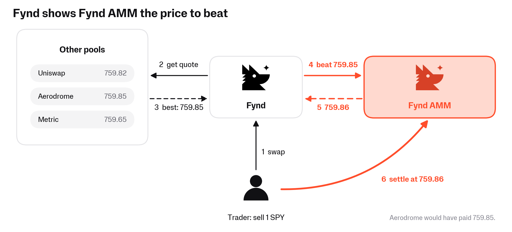
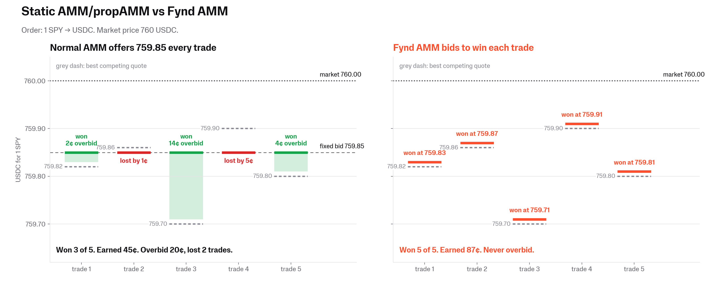
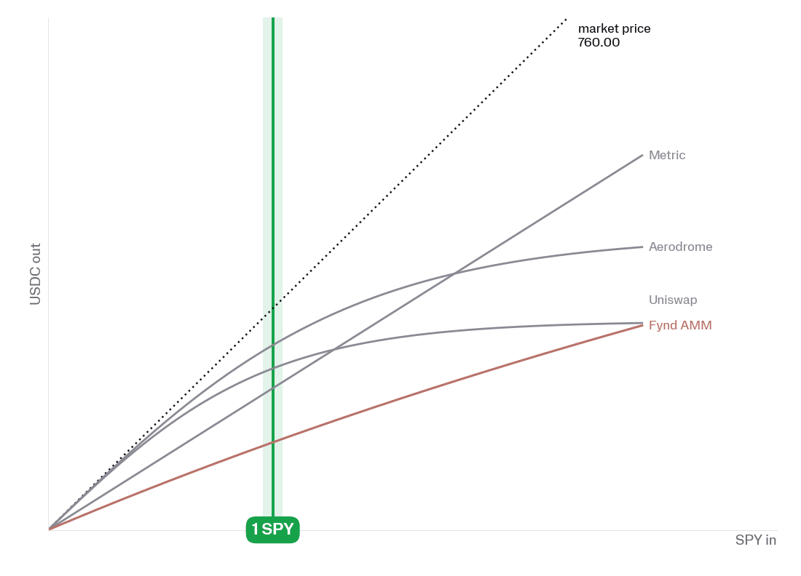
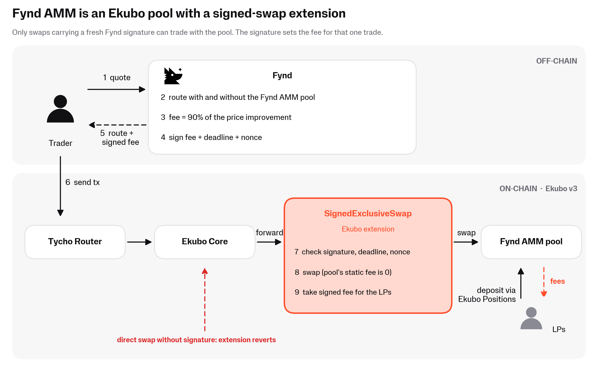
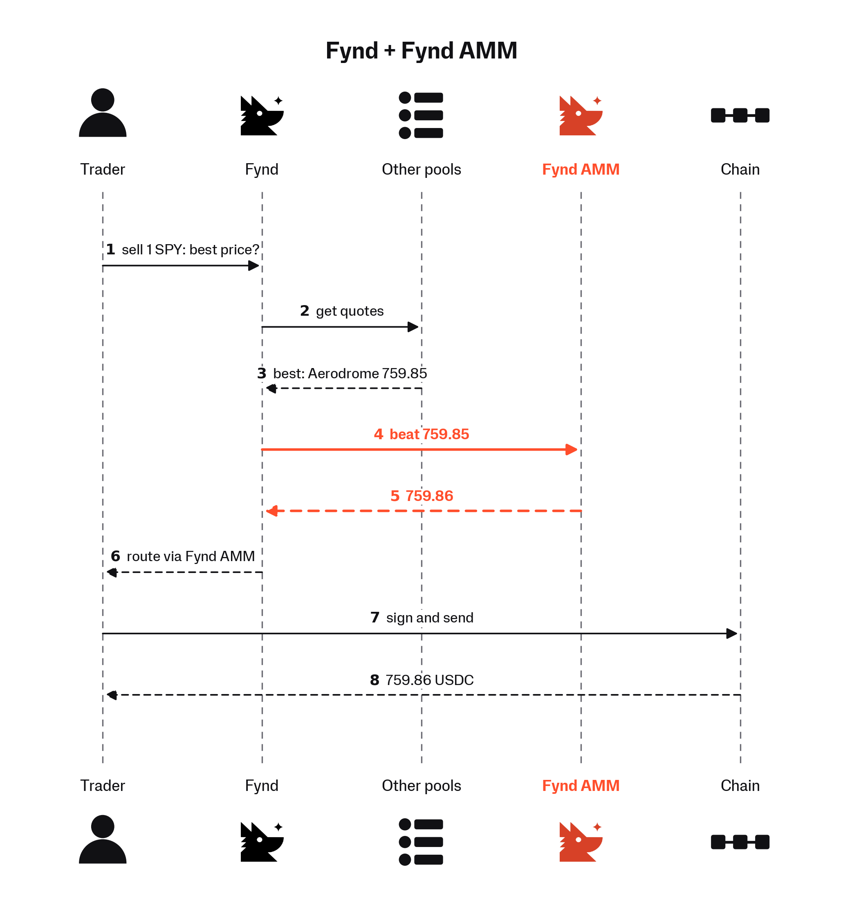

# Fynd AMM

## What is Fynd AMM?

<figure><figcaption></figcaption></figure>

A Fynd AMM pool is a normal concentrated liquidity pool (like a Uniswap v4 or Ekubo pool) with one difference: **Fynd AMM adjusts its fee per trade to outcompete other pools**.

Other AMMs or hooks have fixed fees or adjust their fee per block or even per trade, but are blind to what competing pools bid.

Fynd AMM sets its fee just-in-time, just under the highest fee that still wins the trade.

* **Low competition:** the trade pays a high fee.
* **High competition:** the trade pays a low fee, and the pool still wins it.

Everything else works like any concentrated liquidity position: pick a range, deposit, and earn fees on the trades your liquidity fills.

The first Fynd AMM pools run on [Ekubo](https://ekubo.org/), the most gas-efficient concentrated liquidity AMM. Curve and Metric pools are in the works.

Deposit in Fynd AMM pools: [swap.fynd.xyz/pools](https://swap.fynd.xyz/pools)

## Why competition-aware pools earn more

Every trade is an auction between pools. A router asks every pool "how much USDC do you pay for 1 SPY?" and the best offer wins.

Say SPY trades at 760 USD. AMMs and propAMMs answer:

* Metric: 759.65 USDC
* Uniswap: 759.82 USDC
* Aerodrome: 759.85 USDC

Aerodrome wins. But Aerodrome bid more than it needed: 759.83 would have won too, and its LPs would have kept 2 cents more. Metric lost the trade, even though a bid of 759.86 would have won it at a 14 cent profit.

Fynd AMM fixes this. Fynd looks up the best competing offer and tells Fynd AMM, which bids just above it.

<figure><figcaption></figcaption></figure>

As a result traders get a better price than anywhere else, and the Fynd AMM LPs earn close to the highest fee that still wins the trade.

<figure><figcaption>
Fynd AMM adjusts its bid per trade.
</figcaption></figure>

## How to provide liquidity

1. **Pick a pool** on [swap.fynd.xyz/pools](https://swap.fynd.xyz/pools). Each pool shows TVL, 24h volume, 24h fees, 24h APR, and the range of fees traders paid in the last 24 hours.
2. **Click Deposit.** This opens Ekubo's "new position" page with the Fynd AMM pool preselected.
3. **Choose your price range** and the amounts of both tokens, then confirm the transaction in your wallet. This creates a standard Ekubo position NFT in your wallet.
4. **Monitor** your position on the Fynd pools page (every trade, the fee it paid, and what LPs earned) and on Ekubo.
5. **Withdraw anytime** from Ekubo. There is no lockup.


Always deposit through the Deposit link on the Fynd pools page. Ekubo's generic "Add liquidity" button creates a position in a different pool (same tokens, no extension) that Fynd does not route to. You can identify a Fynd AMM pool by its token pair, a pool fee of `0`, tick spacing `1024`, and the Fynd `SignedExclusiveSwap` extension address listed in [Contracts](fynd-amm.md#contracts).


### Fees and earnings

* Every trade pays the fee Fynd sets for it. Fynd routes exact-input swaps, so the fee is taken in the output token.
* Fynd keeps a 20% owner fee. The rest goes to in-range LPs, pro rata to their liquidity, like on any Ekubo pool.
* Collect fees from your Ekubo position at any time.

### Risks

Fynd AMM pools carry these risks on top of the usual concentrated liquidity risks.

* **Fynd controls the fee, but not your funds.** Fynd signs the fee for each swap. It cannot withdraw, move or lock your liquidity; your position is a standard Ekubo position that only you can withdraw. Fynd can't set the pool's price; it only moves through swaps.
* **Smart contract risk.** Ekubo Core, the Ekubo positions contract, and the `SignedExclusiveSwap` extension. See [Audits](fynd-amm.md#audits).

***

## How it works

The rest of this page is for readers who want the mechanics: who can trade on the pool, what Fynd signs, and what the contracts enforce.

### Overview

<figure><figcaption></figcaption></figure>

1. A trader (via a wallet, aggregator or Fynd InBlock) asks Fynd for a quote.
2. Fynd solves the order twice: once with public liquidity only, and once including the Fynd AMM pool at zero fee.
3. If the Fynd AMM route is better, Fynd sets the fee from the difference.
4. Fynd signs the fee, a deadline, a nonce, and the expected trade size, and encodes the signature into the swap calldata.
5. The trader sends the transaction to the Tycho Router.
6. The router swaps through Ekubo Core, which forwards the swap to the `SignedExclusiveSwap` extension.
7. The extension checks the signature, deadline and nonce, runs the swap at the pool's zero base fee, and takes the signed fee for the LPs.

Any swap that does not carry a valid Fynd signature reverts.

<figure><figcaption></figcaption></figure>

### Who can trade on the pool

Fynd AMM pools are exclusive to Fynd. Trades reach them through:

* the Fynd API, for integrators enabled for Fynd AMM routing;
* Fynd InBlock, which re-solves swaps inside the block and can route them through Fynd AMM pools when that improves the trade;
* the Fynd swap UI at [swap.fynd.xyz](https://swap.fynd.xyz/).

The more flow reaches Fynd, the more trades Fynd AMM pools can win. Deeper pools win larger trades, which brings more fees and more LPs.

### Pool price and the market price

Because only Fynd-signed swaps can trade on the pool, nobody else arbitrages it. Its price only moves when Fynd routes a trade through it, so it can drift away from the market.

On a normal pool a stale price is a loss for LPs: an arbitrageur trades against it at the old price and keeps the difference. On a Fynd AMM pool it isn't:

* When a trade crosses the gap between the pool price and the market price, the fee rule charges that gap to the trade as fee, because the gap is part of the improvement over the public route. The value goes to the LPs.
* Fynd also runs a rebalancing bot that keeps the pool aligned with the market. It trades through the pool and back through a public pool, and its swaps go through Fynd like any other trade. So Fynd charges them the same per-trade fee, and most of the price gap the bot closes goes to the LPs as fees. When the gap is small, that fee is close to zero. These swaps show up in the pool's trades and count toward volume and fees, but the pools page excludes them from the "Swap fee 24h" range.

The gap still matters for LPs in one way: the inventory you hold while the pool lags the market moves with the market. That is ordinary inventory risk, not a fee loss.

### What is signed

Fynd signs an EIP-712 message per swap, which the extension verifies on-chain. It covers:

* **Pool ID:** the signature is valid for one pool only.
* **Fee:** the fee rate for this swap (Q32 fixed point).
* **Deadline:** the signature expires after a short window (about two minutes).
* **Nonce:** each signature can be used once; the extension tracks used nonces in a bitmap.
* **Authorized locker:** only the Tycho Router can execute the swap, so a signature can't be lifted into another contract.
* **Minimum balance update:** bounds on the direction and size of the swap, so a signature quoted for a $1k trade can't be spent on a much larger one.

### Contract guarantees for LPs

The Ekubo extension enforces these properties, not Fynd's off-chain code:

* **No unsigned trades.** The pool is forward-only: direct swaps revert. Nobody can trade against the pool without a fresh Fynd signature.
* **The fee can't be negative.** The pool's base fee is zero and the signed fee is added on top. A trade can never get a better price than the pool's own curve.
* **Fynd has no custody.** LP funds sit in standard Ekubo positions owned by the LPs. The controller key can only sign fees for swaps.
* **Fees are paid out per timestamp.** The extension holds swap fees and pays them to the liquidity in range at the pool's next interaction (a swap, deposit or withdrawal) with a later block timestamp. On chains with sub-second blocks, several blocks share one timestamp. A withdrawal collects the fees you are owed, except fees from swaps with the same timestamp as your withdrawal. If no liquidity is in range when fees are paid out, they are lost.

### Contracts

Ekubo `SignedExclusiveSwap` extension (Fynd controller):

* Ethereum: `0x55b703eED01b35641963da2FB2E14885993605A3`
* Robinhood Chain: `0x550CFe1292d0D9c0d28f232b3F42Edb4439B1D09`

Live pools (Ekubo pool IDs):

* Ethereum, ETH/USDC: `0x9efd723a29a4e7f40c955f7b968144a5e2a7261a4a0f1573fbb0e2653600e4a4`
* Robinhood Chain, ETH/USDG: `0xb67e0601a0363a1ad259dd848cad1c52d6cc4eb18bc526a0dd4f4bdf83773546`
* Robinhood Chain, SPY/USDG: `0xf893e7a59d7645501877e680332860a61f784332e7e722a5e9bb9a8cbad38656`
* Robinhood Chain, PONS/USDG: `0xbc2615db1f10ca2f2cc9d491fe697ac8a11290f8c900fad313be53bb6763df79`
* Robinhood Chain, AI/USDG: `0x46e76723bc9334ec559b6c1302a8ac15bef0edbdc42ce139a642df711eae9715`
* Robinhood Chain, UBIK/USDG: `0x29936f43df20cce7583ff081144b26fc8984cd38d3f413f04695640928729524`

All pools use pool fee `0` and tick spacing `1024`.

### Audits

The `SignedExclusiveSwap` extension is part of Ekubo's [evm-contracts](https://github.com/EkuboProtocol/evm-contracts) and runs on Ekubo Core, which has its own audits ([Code4rena, Riley Holterhus](https://github.com/EkuboProtocol/evm-contracts/tree/main/audits)). The extension itself has had automated security reviews, and is currently under manual audit:

* [**Cantina Apex audit scan**](https://github.com/EkuboProtocol/evm-contracts/blob/main/audits/EkuboProtocol%20Audit%20Scan%20-%20AI%20Scan.pdf) (July 2026, evm-contracts commit `7b8b0a0`): no critical, high or medium findings. One informational finding on the extension (EKUB3-64: zero-amount swaps consume a nonce).
* [**Extension review**](https://github.com/EkuboProtocol/evm-contracts/blob/main/audits/SignedExclusiveSwap-Extension-Audit.md) (June 2026): no critical or high findings; Ekubo fixed the low-severity items before deployment.
* [**V12 review of the owner fee change**](https://github.com/EkuboProtocol/evm-contracts/pull/373) (September 2026): one issue fixed (input overflow on exact-output swaps), one acknowledged by design (fees go to the liquidity in range when they are paid out, see [Contract guarantees for LPs](fynd-amm.md#contract-guarantees-for-lps)).

### Further reading

* [Fynd In-Block Solver](/broken/pages/c8ca654eacf3b9c983b3b6543ca6b32d263f18c5)
